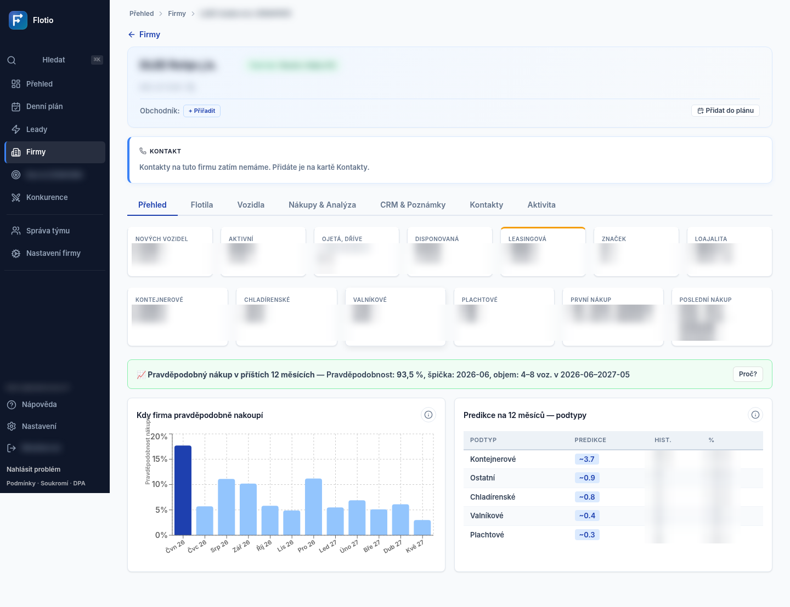
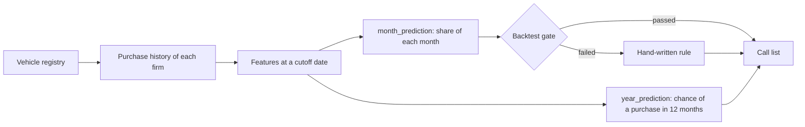
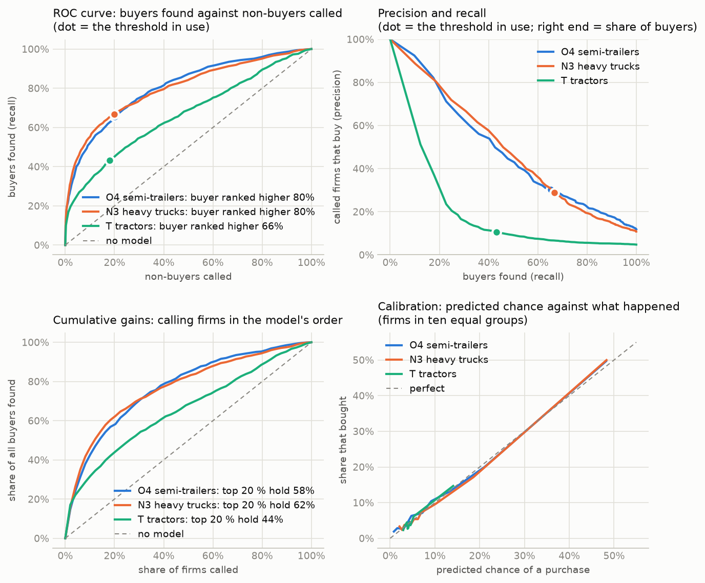
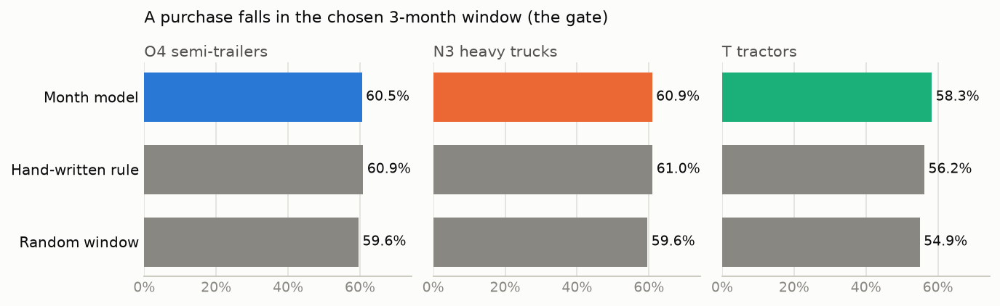

# Flotio prediction core

Two models that tell a sales team **which firms will buy a vehicle in the next
12 months** and **in which month**. They are the prediction core of Flotio, a
market-intelligence product I built over the Czech vehicle registry; this
repository is a standalone version of that core with its results on the real
registry.

**In short**

- **Who buys: works.** On the real registry, given one buyer and one
  non-buyer, the model ranks the buyer higher 80 % of the time for
  semi-trailers and heavy trucks. The tenth of firms it ranks highest holds
  42 to 46 % of all buyers, and half of those firms bought, against one firm
  in nine overall.
- **In which month: barely better than chance.** The month the model ranks
  first is right about 17 % of the time, against 16 % for a random month. A
  backtest gate decides per vehicle category whether the month model is used;
  it failed on two of three, and there the product keeps its hand-written
  rule.
- **The code is a sketch of the production core:** two model packages
  ([`year_prediction`](src/flotio_core/year_prediction/README.md), [`month_prediction`](src/flotio_core/month_prediction/README.md)) and an
  evaluation module, about 900 lines, 18 tests. The registry and customer data are not here; only aggregate
  results are.

## What it is for

Flotio's customers are vehicle manufacturers and dealers. From the public
registry (about 19 million vehicles and 90 million ownership records) the
product builds each firm's purchase history, scores the firms and gives the
sales team a call list.

**One firm.** The 12-month chance of a purchase and how that chance is spread
over the months. This is the output of the two models in this repository.



The screenshot is from a development copy of the app; the interface is in
Czech. The firm's name and registration number, the customer's name, the
account, the fleet counts and the dates are blurred.

## How it works



| | [`year_prediction/`](src/flotio_core/year_prediction/README.md) | [`month_prediction/`](src/flotio_core/month_prediction/README.md) |
|---|---|---|
| Question | Will this firm buy in the next 12 months? | In which of those months? |
| Model | gradient-boosted classifier, one row per firm | discrete-time hazard: one row per firm × month-start × months-ahead |
| Inputs | purchase counts, recency, gaps, trend, brand loyalty, vehicle age and weight, calendar-month shares | recency, counts over 3 to 60 months, usual and last gap, months-ahead, target calendar month |
| Output | calibrated probability and a yes/no call | the share of each month in the firm's chance |
| Details | [features, hyperparameters, threshold](src/flotio_core/year_prediction/README.md) | [features, hyperparameters, hand-written rule](src/flotio_core/month_prediction/README.md) |

The 12-month chance from `year_prediction` is split over the months by
`month_prediction`. In code, the whole flow is a few calls:

```python
from datetime import date
import polars as pl
from flotio_core import month_prediction, year_prediction

today = date(2026, 1, 1)
purchases = pl.read_parquet("purchases.parquet")  # one row per vehicle: firm, purchase_date, brand, year_built, weight

# Year model: trains on 2023, sets the threshold and the calibration on 2024.
model = year_prediction.fit(purchases, date(2024, 1, 1))
firms, chance, call = model.predict(purchases, today)  # 12-month chance and the yes/no call per firm

# Month model: used only if it is at least as good as the hand-written rule in a backtest.
gate = month_prediction.backtest(purchases, date(2024, 1, 1), today)
if gate["passed"]:
    months = [year_prediction.add_months(today, h) for h in range(12)]
    shares = month_prediction.month_shares(
        month_prediction.train(purchases, today), purchases, months
    )  # firm -> share of each month
```

## Results

Both models were run on the real registry on 2026-11-20 (data to 2026-09) by
the code in this repository. The detail, including the stability over five
test years, is in [`docs/RESULTS.md`](docs/RESULTS.md). A forward check on
September and October 2026, months no model had seen, is in
[`docs/FORWARD.md`](docs/FORWARD.md): the ranking held up.

### Who buys: works

Trained on the cutoff 2023-09, threshold and calibration set on 2024-09, judged
once on the cutoff 2025-09, whose following 12 months were used for nothing
else.

| Vehicle category | Firms | Bought within 12 months | Buyer ranked above a non-buyer (95 % interval) | Buyers in the top tenth of firms | Recall | Precision |
|---|---:|---:|---:|---:|---:|---:|
| O4 semi-trailers | 8,440 | 11.8 % | 80 % (79 to 82 %) | 42 % | 65 % | 30 % |
| N3 heavy trucks | 14,136 | 10.8 % | 80 % (79 to 81 %) | 46 % | 67 % | 29 % |
| T tractors | 25,143 | 4.7 % | 66 % (64 to 68 %) | 31 % | 43 % | 11 % |

- **Ranking.** Take one firm that bought and one that did not: for trailers
  and trucks the model scores the buyer higher four times in five. The tenth
  of firms it ranks highest holds 42 to 46 % of all buyers.
- **The call.** For trailers and trucks, at the threshold in use the model
  flags a quarter of the firms and finds two thirds of the buyers. For trailers
  that is one buyer in three calls, against one in eight without the model.
- **Stability.** Over five test years, each with a model fitted only on
  earlier years, about three called firms in ten bought in every year for
  trailers and trucks, and the calls found 58 to 67 % of the buyers.
- **Tractors are the weak category.** The registry holds under 3 purchases per
  tractor firm, against about 12 for trailers and trucks, so there is little
  history to learn from.



### In which month: hard

The model is trained on data before 2024-09 and judged on the 12 month-starts
after it. Among the firms that bought in the next 12 months, the share for which
the month ranked first had a purchase:

| Vehicle category | Month model | Hand-written rule | Random month |
|---|---:|---:|---:|
| O4 semi-trailers | 17.2 % | 17.6 % | 15.6 % |
| N3 heavy trucks | 17.6 % | 17.6 % | 15.8 % |
| T tractors | 13.1 % | 13.4 % | 11.6 % |

Both the model and the rule beat a random month by under two points. On the
question of which month, the model holds almost no information, and neither
does the hand-written rule.

The gate compares the model's 3-month window with the rule's, and both with a
window chosen at random: the share of firms that bought for which the chosen
window contained a purchase.

| Vehicle category | Month model | Hand-written rule | Random window | Gate |
|---|---:|---:|---:|---|
| O4 semi-trailers | 60.5 % | 60.9 % | 59.6 % | failed, the rule stays |
| N3 heavy trucks | 60.9 % | 61.0 % | 59.6 % | failed, the rule stays |
| T tractors | 58.3 % | 56.2 % | 54.9 % | passed |

Over a random window, the model gains 0.9 to 3.3 points and the rule 1.3 to
1.4.



## Layout

| Path | What it is |
|---|---|
| [`src/flotio_core/year_prediction/`](src/flotio_core/year_prediction/README.md) | the 12-month model, one file per use; its README lists the features and hyperparameters |
| &nbsp;&nbsp;`features.py` | cutoff dates, purchase history to per-firm inputs and the 12-month label, brand encoding |
| &nbsp;&nbsp;`model.py` | the classifier: `fit()` trains and calibrates it, `WhoModel.predict()` scores firms |
| &nbsp;&nbsp;`threshold.py` | the yes/no call: metrics at a threshold, the threshold chosen by its cost |
| [`src/flotio_core/month_prediction/`](src/flotio_core/month_prediction/README.md) | the month model, one file per use; its README lists the features, hyperparameters and the hand-written rule |
| &nbsp;&nbsp;`history.py` | month indexing, purchase history to per-firm inputs and month labels |
| &nbsp;&nbsp;`model.py` | the monthly hazard model: `train()` and `HazardModel.predict()` |
| &nbsp;&nbsp;`shares.py` | `month_shares()`: each month's share of a firm's chance, what callers use |
| &nbsp;&nbsp;`rule.py` | `rule_profile()`: the hand-written rule, the baseline |
| &nbsp;&nbsp;`backtest.py` | `backtest()`: the gate, model vs rule vs random |
| `src/flotio_core/evaluate.py` | the metrics behind the results: ranking, the yes/no call, calibration, walk-forward, month placement |
| `examples/evaluate.py` | full evaluation of one vehicle category from a purchases file, saved as JSON |
| `tools/plot_report.py` | draws the charts in `docs/figures/` from the reports in `docs/results/` |
| `docs/RESULTS.md` | the results in detail: the yes/no call, stability over five years, the month tables |
| `docs/FORWARD.md` | forward check on September and October 2026, from a newer registry release |
| `docs/results/` | evaluation reports from the real registry, one per vehicle category (aggregates only); `forward_*.json` for the forward check |
| `tests/` | 18 tests: point-in-time inputs, labels, encoder reuse, threshold, month shares, metrics against hand counts |

## Run

Needs Python 3.11+.

```bash
pip install -e ".[dev,plots]"
pytest
python tools/plot_report.py      # the charts in docs/figures/ from docs/results/

# with a purchase history of your own (parquet or csv, columns as in the example above):
python examples/evaluate.py purchases_O4.parquet O4 "O4 semi-trailers" --data-end 2026-09-01
```

## What is different from production

[`month_prediction/`](src/flotio_core/month_prediction/README.md) is the production module, split into files by use, with
the column names translated. [`year_prediction/`](src/flotio_core/year_prediction/README.md) is a reduced rewrite of the
production script, split the same way: it keeps the method and drops what
depends on the registry or on customer data.

- Left out: vehicle sub-type shares, macro-economic indicators, sales-outcome
  features from the CRM, SHAP explanations, model versioning and the database
  layer.
- Also left out: features built from the fleet's registration status
  (de-registrations).
- No registry data, no firm-level predictions and no customer data are in
  this repository.
