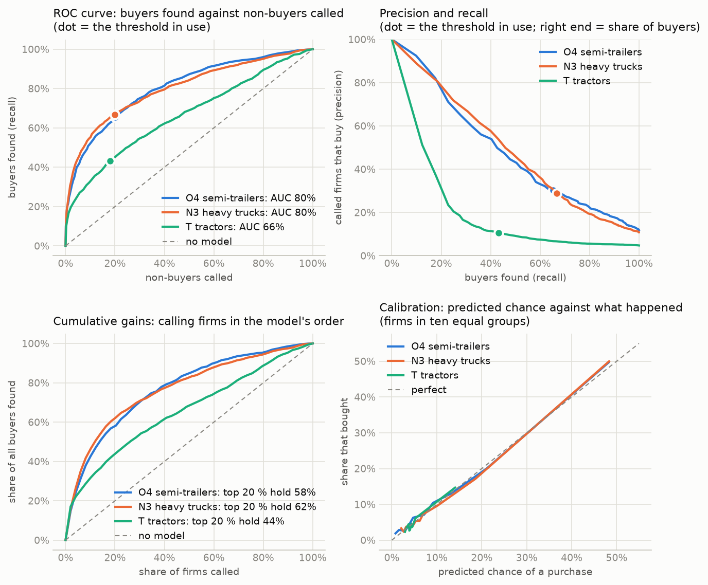
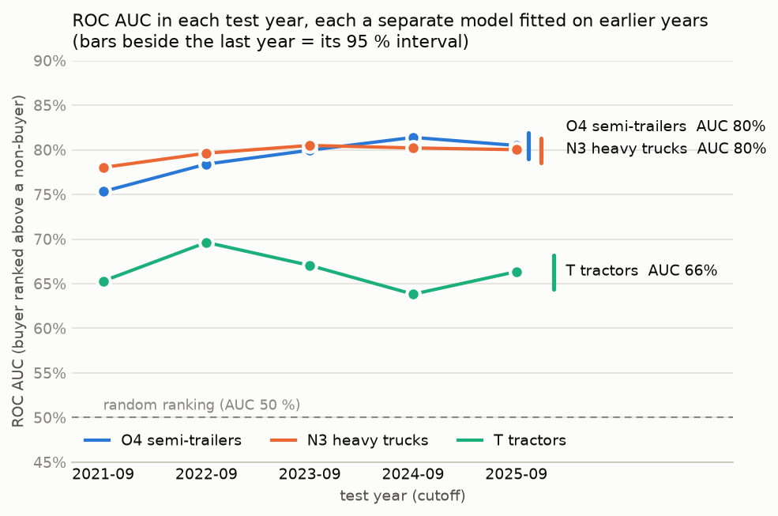

# Results in full

The summary is in the [README](../README.md#results). This file has the detail
behind it.

- **Who buys** works: given one buyer and one non-buyer, the model ranks the
  buyer higher 80 % of the time for trailers and heavy trucks and 66 % for
  tractors.
- **In which month** is hard: the month model's first choice is right about
  17 % of the time, against 16 % for a random month. A backtest gate keeps it
  out of the product wherever it does not match the hand-written rule.

Both models were run on the real registry on 2026-11-20 (data to 2026-09) by
the code in this repository. Only aggregate figures leave the registry: the
reports are in [`results/`](results/) and `tools/plot_report.py` draws the
charts from them. The registry data and its loader are not in the repository.

A forward check on September and October 2026, months after the data these
runs used, is in [FORWARD.md](FORWARD.md).

Contents: [Who buys](#who-buys) · [In which month](#in-which-month)

## Who buys

`year_prediction.fit()` trained on the cutoff 2023-09, set its threshold and calibration on
2024-09, and was judged once on the cutoff 2025-09, whose following 12 months
were used for nothing else.

How to read the four charts:

- **ROC curve** (top left): as the model calls more firms, the share of
  buyers it finds against the share of non-buyers it calls. The higher the
  curve above the dashed line, the better the ranking. The legend gives the
  area under the curve (ROC AUC): how often a buyer is ranked above a
  non-buyer.
- **Precision and recall** (top right): the share of called firms that buy
  against the share of buyers found, for every possible threshold.
- **Cumulative gains** (bottom left): the share of all buyers reached when
  firms are called in the model's order. For trailers, the top 20 % of firms
  hold 58 % of the buyers.
- **Calibration** (bottom right): firms grouped by predicted chance, against
  the share that actually bought. On the dashed line a predicted 20 % means
  one firm in five bought.

### The yes/no call

The call uses the threshold chosen a year earlier, set so that at most 20 %
of non-buyers are called.

| Vehicle category | Firms called | Recall | Precision | Accuracy |
|---|---:|---:|---:|---:|
| O4 semi-trailers | 2,147 (25 %) | 65 % | 30 % | 78 % |
| N3 heavy trucks | 3,524 (25 %) | 67 % | 29 % | 79 % |
| T tractors | 4,848 (19 %) | 43 % | 11 % | 80 % |

For trailers, calling the flagged firms means about one buyer in three calls,
against one in eight without the model.

Accuracy is shown because it is the measure people ask for, and it is the
wrong one here. Only about one trailer firm in eight buys, so calling nobody
is 88 % accurate and finds no buyer. The threshold gives up accuracy on
purpose: a wasted call is cheap and a missed buyer is not.

### Stability over five test years

Each column is a separate model, fitted only on the years before its test
cutoff.

**Ranking.** How often a buyer is ranked above a non-buyer (ROC AUC). It does
not depend on the threshold or on how many firms buy, so it is the cleanest
measure of whether the model holds from year to year.

| Vehicle category | 2021-09 | 2022-09 | 2023-09 | 2024-09 | 2025-09 |
|---|---:|---:|---:|---:|---:|
| O4 semi-trailers | 75 % | 78 % | 80 % | 81 % | 80 % |
| N3 heavy trucks | 78 % | 80 % | 80 % | 80 % | 80 % |
| T tractors | 65 % | 70 % | 67 % | 64 % | 66 % |

Trucks held at 78 to 80 %. Trailers rose from 75 % to 80 to 81 % in the last
three years. Tractors moved between 64 % and 70 % with no trend.

**The yes/no call.** Each cell is **precision / recall**:

- **precision**: of the firms the model called, the share that bought;
- **recall**: of all firms that bought, the share the model called.

For example, "30 % / 58 %" for trailers in 2021-09 means that 30 % of the
called firms bought, and the calls reached 58 % of all buyers.

| Vehicle category | 2021-09 | 2022-09 | 2023-09 | 2024-09 | 2025-09 |
|---|---:|---:|---:|---:|---:|
| O4 semi-trailers | 30 % / 58 % | 30 % / 62 % | 28 % / 65 % | 31 % / 67 % | 30 % / 65 % |
| N3 heavy trucks | 30 % / 62 % | 32 % / 65 % | 30 % / 67 % | 30 % / 67 % | 29 % / 67 % |
| T tractors | 17 % / 42 % | 17 % / 50 % | 13 % / 44 % | 11 % / 40 % | 11 % / 43 % |

For trailers and trucks about three called firms in ten bought in every year.
Tractor precision fell from 17 % to 11 % because fewer tractor firms buy each
year (8 % of firms in 2021-09, under 5 % in 2025-09), not because the model got
worse: recall held at 40 to 50 %.

The share of non-buyers called stayed between 18 % and 21 % in all fifteen
runs, so a budget set a year ahead holds. Only the 2025-09 column is a clean
test: the production model was designed while looking at the earlier years, so
those columns show stability, not an untouched result.

### What the model relies on

Purchases in the last five years carry about 30 % of the model's importance for
trailers and trucks, followed by total purchases, the number of active years
and the months since the last purchase. In plain terms the model learns that
firms which buy often keep buying. Tractors are the weakest category for the
same reason: the registry holds under 3 purchases per tractor firm, against
about 12 for trailers and trucks, so there is little history to learn from.

## In which month

### The gate

`month_prediction.backtest()`: the model is trained on data before 2024-09 and judged on
the 12 month-starts after it. The number is the share of firms that bought,
for which the chosen 3-month window contained a purchase. A random window is
the average over the four windows the gate chooses from.

| Vehicle category | Month model | Hand-written rule | Random window | Gate |
|---|---:|---:|---:|---|
| O4 semi-trailers | 60.5 % | 60.9 % | 59.6 % | failed, the rule stays |
| N3 heavy trucks | 60.9 % | 61.0 % | 59.6 % | failed, the rule stays |
| T tractors | 58.3 % | 56.2 % | 54.9 % | passed |

The gate passes when the model is at least as good as the rule. On two of the
three categories it is not, and there the product keeps the hand-written rule.
Both beat a random window by only 1 to 3 points.

The month model's number moves by up to half a point between runs on the same
data (the rule's does not), so for trailers and trucks the model and the rule
are effectively tied. This table comes from a rerun of the gate on 2026-11-20;
the table below is from the first run.

### Placing the month

`evaluate.month_report()` looks only at the firms that did buy: is the month
the model ranks first a month with a purchase, and is one of its three
highest? Each cell is "first choice / one of the top three".

| Vehicle category | Month model | Hand-written rule | Random month |
|---|---:|---:|---:|
| O4 semi-trailers | 17.2 % / 37.8 % | 17.6 % / 39.1 % | 15.6 % / 37.6 % |
| N3 heavy trucks | 17.6 % / 40.5 % | 17.6 % / 40.3 % | 15.8 % / 37.9 % |
| T tractors | 13.1 % / 34.3 % | 13.4 % / 32.7 % | 11.6 % / 30.5 % |

The model's first choice is right about 17 % of the time for trailers and
trucks, against 16 % for a month drawn at random. It holds almost no timing
information, and neither does the hand-written rule. That is the result, and
the gate keeps the model out of the product wherever it does not at least
match the rule.

